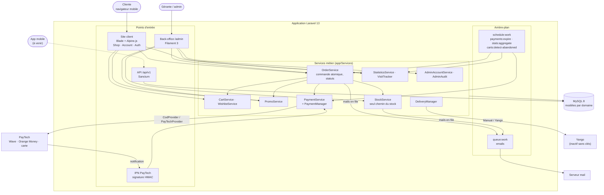
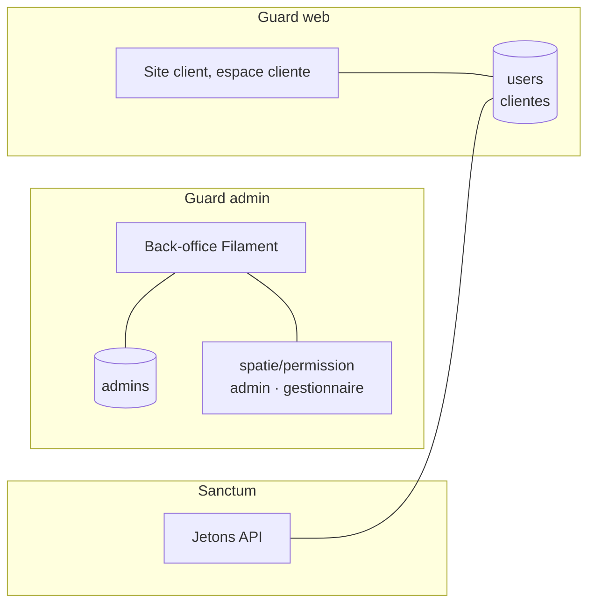
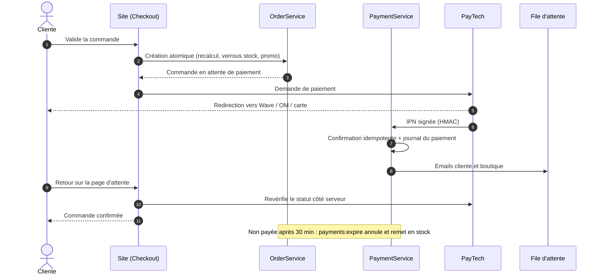

# Aissatou Store

Boutique e-commerce de mode féminine (voiles et hijabs, foulards, cols, parfums, sacs à main, cadeaux), mono-vendeur, mobile-first, pour le Sénégal. Prix en FCFA, paiement à la livraison ou en ligne (Wave, Orange Money, carte via PayTech).

## Fonctionnalités

**Site client**
- Catalogue avec catégories, collections, matières, recherche et filtres AJAX, images WebP responsives
- Accueil éditorial : hero en carrousel (photo paysage plein écran au format 16:9 ; photo portrait sur la moitié droite, texte sur fond clair ; version téléphone dédiée), bandeau défilant facultatif, univers en mosaïque, nouveautés, « Le Look » (pièces d'une tenue mises en avant tour à tour), « La Maison » (photo à effet de profondeur), parcours « L'expérience Aissatou », avis clients avec note moyenne ; apparition douce au défilement et zoom des photos au survol (désactivés en « animations réduites »)
- Collections en chapitres (sommaire, photo, aperçu des pièces) et journal en magazine (article à la une, temps de lecture, partage WhatsApp)
- Panier invité et compte (fusion à la connexion), liste d'envies, avis clients
- **Espace cliente** : salutation selon l'heure de son appareil, badge « Cliente fidèle », commande en cours avec frise de suivi datée, coups de cœur, profil à compléter, adresses, historique des commandes, déconnexion
- Page contact : WhatsApp, e-mail, formulaire, réseaux sociaux ; afficher/masquer le mot de passe sur tous les formulaires
- Tunnel de commande : récapitulatif, code promo, frais de livraison par zone calculés côté serveur, choix du paiement
- **Paiement en ligne PayTech** : redirection, page d'attente qui revérifie le statut côté serveur, nouvel essai en cas d'échec, annulation automatique (et remise en stock) des commandes impayées après 30 min

**Back-office (`/admin`, Filament)**
- **Tableau de bord** : chiffre d'affaires encaissé, commandes payées, panier moyen, taux de conversion (compteur de visites maison et anonyme, sans cookie ni IP stockée), paniers abandonnés, meilleures ventes, comparaison à la période précédente ; agrégats quotidiens pour rester rapide quel que soit l'historique
- Catalogue, contenu éditorial, réglages du site (photos distinctes pour la connexion et « La Maison », bandeau défilant masqué quand il est vide), zones de livraison, messages reçus
- **Charte photo** : un format et un minimum par emplacement (refus des photos trop petites, badge « À remplacer »), point focal réglable avec aperçu de chaque recadrage
- Commandes : statuts avec transitions contrôlées et historique, facture PDF, organisation de la livraison
- **Paiements** : une ligne par paiement en ligne ; la fiche donne le statut réel, la référence de transaction et tout le déroulement expliqué en français (journal immuable), vérification auprès du fournisseur ; onglet « Messages suspects » pour les notifications rejetées
- **Codes promo** : pourcentage ou montant fixe, validité, minimum d'achat, ciblage produits/catégories, plafond d'utilisations (compteur atomique, revalidation complète à la validation de la commande), utilisation rendue si la commande est annulée
- **Stock** : inventaire par catégorie, fiche par déclinaison avec son historique, ajustement manuel avec motif obligatoire, journal immuable des mouvements, alertes email de stock faible (seuil global ou par déclinaison) avec lien vers la fiche de l'article
- **Clients** : segmentation (régulières, panier abandonné, inactives), historique complet des achats, lecture seule et consultation tracée
- **Comptes admin et rôles** : admin complet ou gestionnaire (catalogue, stock, commandes), permissions revérifiées côté serveur sur chaque page et action, journal d'activité lisible (une phrase en clair par action : connexions, comptes, commandes, réglages)

**API** : Laravel Sanctum, endpoints versionnés sous `/api/v1` (lecture du catalogue, authentification par jeton), en prévision d'une app mobile.

## Avancement

| Phase | Contenu | État |
|---|---|---|
| 1 | Fondations (auth séparée client/admin, catalogue, API) | ✅ |
| 2 | Expérience client (catalogue, panier, compte, accueil éditable) | ✅ |
| 3 | Tunnel de commande + paiement à la livraison | ✅ |
| 4 | Livraison (zones, suivi manuel ; Yango prêt, inactif sans clés) | ✅ |
| 5 | Paiement en ligne PayTech (Wave, Orange Money, carte) | ✅ |
| 6 | Back-office avancé : rôles, stock, codes promo, statistiques, segmentation clients | ✅ |
| 7 | Finalisation et mise en production | ⏳ |

## Stack technique

- **Backend** : Laravel 13, PHP 8.4 (8.4.27 minimum, correctifs « php2shell »), organisation par domaine (`App\Models\Catalogue`, `Order`, `Delivery`…)
- **Base de données** : MySQL 8
- **Site client** : Blade, Alpine.js, Tailwind CSS (Vite)
- **Back-office** : Filament 3, guard `admin` totalement séparé du guard `web` des clients (table `admins`)
- **Rôles et permissions** : spatie/laravel-permission
- **PDF** : barryvdh/laravel-dompdf
- **Paiement en ligne** : PayTech (API REST + notifications IPN signées HMAC)

## Architecture

### Vue d'ensemble



Les contrôleurs restent minces : toute règle métier (prix, stock, promo, statut) passe par un service, recalculée côté serveur. Paiement et livraison sont derrière un contrat (`PaymentProvider`, `DeliveryProvider`) : ajouter un fournisseur ne touche pas au tunnel.

### Deux mondes d'authentification séparés



### Parcours d'un paiement en ligne



## Démarrage local

```bash
composer install
npm install && npm run build      # ou npm run dev en développement
cp .env.example .env
php artisan key:generate
```

Renseigner au minimum dans `.env` : `DB_*` (MySQL) et `ADMIN_SEED_EMAIL` / `ADMIN_SEED_PASSWORD` (compte admin créé par le seeder).

```bash
php artisan migrate --seed        # inclut rôles/permissions, admin, catalogue et commandes de démo
php artisan storage:link          # images produit
PHP_CLI_SERVER_WORKERS=8 php artisan serve --no-reload
```

Processus d'arrière-plan à lancer à côté du serveur :

```bash
php artisan queue:work            # emails (commandes, statuts, alertes de stock)
php artisan schedule:work         # tâches planifiées (impayés PayTech, agrégats statistiques, paniers abandonnés)
```

- Site client : `http://localhost:8000`
- Back-office : `http://localhost:8000/admin` (identifiants = `ADMIN_SEED_EMAIL` / `ADMIN_SEED_PASSWORD`)
- Clientes de démo : `aicha.demo@example.com` et `fatou.demo@example.com`, mot de passe `password` (créées par `OrderDemoSeeder`)

### Variables d'environnement propres au projet

| Variable | Rôle |
|---|---|
| `ADMIN_SEED_EMAIL`, `ADMIN_SEED_PASSWORD` | Premier compte admin (seeder) |
| `PAYTECH_API_KEY`, `PAYTECH_API_SECRET` | Clés PayTech. Vides = paiement en ligne masqué dans le tunnel |
| `PAYTECH_ENV` | `test` (sandbox) ou `prod` (exige un compte marchand activé par PayTech) |
| `PAYTECH_IPN_URL` | URL publique HTTPS de l'IPN si `APP_URL` n'est pas joignable depuis Internet |
| `PAYMENT_EXPIRE_MINUTES` | Délai avant annulation d'une commande payable en ligne non payée (défaut 30) |
| `TRUSTED_PROXIES` | IP des proxies de confiance (vide par défaut ; `127.0.0.1` derrière ngrok en local) |
| `YANGO_CLIENT_ID`, `YANGO_KEY` | Transporteur Yango. Vides = livraison manuelle uniquement |

Les secrets ne vont que dans `.env`, jamais dans le dépôt.

### Tester le paiement en ligne en local

PayTech doit pouvoir joindre l'IPN en HTTPS, et le client doit revenir sur le site après paiement. Il faut donc exposer tout le site via un tunnel :

```bash
ngrok http 8000
```

Puis dans `.env` : `APP_URL=https://xxxx.ngrok-free.app`, `PAYTECH_IPN_URL=https://xxxx.ngrok-free.app/paiement/paytech/ipn`, `TRUSTED_PROXIES=127.0.0.1`, et `php artisan config:clear`. Naviguer ensuite sur l'URL ngrok (pas sur `localhost`).

En sandbox (`PAYTECH_ENV=test`), PayTech débite réellement 100 à 150 FCFA sur le compte payeur, quel que soit le montant de la commande.

## Déploiement

À chaque mise en production, après `php artisan migrate --force` :

```bash
php artisan db:seed --class=RolePermissionSeeder --force   # aligne rôles et permissions sur le code
```

Sans cette étape, aucun compte admin n'a accès au back-office : en cas de doute, l'accès est refusé.

Prévoir aussi un worker de file (`queue:work`, supervisé) et la tâche cron `* * * * * php artisan schedule:run`.

Serveur : PHP 8.4.27 ou plus (`composer install` refuse une version plus ancienne, exposée aux CVE-2026-109618/109619), et `session.upload_progress.enabled=0` dans le `php.ini` (précaution recommandée pour CVE-2026-115560). L'envoi d'e-mails (`MAIL_*`) doit être configuré : une nouvelle cliente doit vérifier son adresse avant de commander.

## Tests et qualité

```bash
php artisan test
./vendor/bin/pint --test          # style de code
```

Les tests tournent sur une base MySQL dédiée (`phpunit.xml` ne surcharge que `DB_CONNECTION` / `DB_DATABASE` ; les identifiants viennent de `.env`). Aucun appel réseau réel : PayTech est simulé (`Http::fake`, `preventStrayRequests`).

GitHub Actions (`.github/workflows/ci.yml`) exécute à chaque push et PR sur `main` : Pint, migrations sur MySQL 8, suite de tests complète.

## Structure du projet

```text
app/
├── Http/
│   ├── Controllers/
│   │   ├── Shop/              site client et tunnel (accueil, catalogue, panier, commande, journal, contact)
│   │   ├── Account/           espace cliente (tableau de bord, commandes, adresses)
│   │   ├── Auth/              inscription, connexion, mot de passe (guard web)
│   │   ├── Payment/           IPN PayTech (signature HMAC)
│   │   ├── Admin/             facture PDF
│   │   └── Api/V1/            catalogue et authentification par jeton (Sanctum)
│   └── Middleware/TrackVisit  compteur de visites anonyme
│
├── Services/                  logique métier : les contrôleurs et Filament passent par ici
│   ├── OrderService           création atomique (recalcul serveur, verrous anti-survente), transitions de statut
│   ├── StockService           seul chemin de variation du stock (journalisé), alertes de stock faible
│   ├── PromoService           aperçu et décision finale des codes promo (verrou + incrément conditionnel)
│   ├── CartService, WishlistService, AddressService
│   ├── StatisticsService, VisitTracker   tableau de bord et visites
│   ├── AdminAccountService, AdminAudit   comptes admin et journal d'activité
│   ├── ImageVariantGenerator  variantes WebP responsives (480 → 2 400 px)
│   ├── Payment/               contrat PaymentProvider → CodProvider, PayTechProvider ;
│   │                          PaymentManager (choix), PaymentService (confirmation idempotente)
│   └── Delivery/              contrat DeliveryProvider → Manual, Yango ; DeliveryManager
│
├── Models/                    par domaine
│   ├── Catalogue/             produits, déclinaisons, images, catégories, collections, matières, mouvements de stock
│   ├── Order/                 commandes, lignes, historique de statut, paiements, journal des paiements, codes promo
│   ├── Cart/, Wishlist/, Customer/ (adresses), Delivery/ (zones)
│   ├── Content/, Contact/     accueil (hero, « Le Look »), journal, avis, réglages, messages
│   ├── User                   clientes (guard web)
│   └── Admin, AdminActivity   comptes back-office (guard admin) et journal d'activité
│
├── Filament/                  back-office /admin
│   ├── Resources/             Catalogue, Order, Customer, Content, Delivery, Admin
│   ├── Clusters/              Paiements, Stock
│   ├── Pages/, Widgets/       tableau de bord, réglages du site, graphiques
│   ├── Forms/                 champs réutilisables (point focal avec aperçu des recadrages)
│   └── Concerns/              traits de contrôle d'accès par permission
│
├── Enums/                     statuts (commande, paiement…), permissions admin (AdminPermission)
├── Support/                   AdminRoles (rôles, le code fait foi), ImageSlot (charte photo : format, minimum,
│                              recadrage par emplacement), textes lisibles des journaux, périodes de stats
├── Mail/                      emails en file : commande, statut, alerte boutique, stock faible
├── Observers/                 génération d'images à l'enregistrement du contenu
└── Console/Commands/          payments:expire (5 min), stats:aggregate (nuit, --from=AAAA-MM-JJ),
                               carts:detect-abandoned (heure), images:generate-variants

routes/        web.php · shop.php · account.php · auth.php · api.php · console.php (planification)
resources/     views/ (shop, account, auth, emails, pdfs, filament…), css/, js/ (Tailwind, Alpine, Vite)
database/      migrations, factories, seeders (rôles et permissions, admin, catalogue et commandes de démo)
tests/Feature/ par domaine : Shop, Account, Order, Payment, Delivery, Catalogue, Admin, Api, Auth
```

La documentation interne (cahier des charges, journaux de phase) est conservée hors dépôt.
